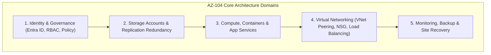

      

# Microsoft Certified: Azure Administrator Associate (AZ-104) Study Guide

> **Author & Architect:** [Robina Mirbahar](https://github.com/RobinaMirbahar) (Google Developer Expert in Cloud & AI)  
> **Focus:** Multi-Cloud Infrastructure Reference Covering Azure Identity (Entra ID), VNet Peering, Storage, Compute & Governance

---

## 🎯 Why I Built AZ-104 Microsoft Azure Administrator — Complete Study & Lab Guide (Engineering Purpose & Real-World Value)

### 1. 🌐 Multi-Cloud Fluency for Enterprise Architects
Enterprise workloads frequently span Google Cloud and Microsoft Azure. I curated this structured AZ-104 study and lab guide to provide a hands-on reference for identity federation, virtual networking, storage redundancy, and RBAC governance.

### 2. 🛠️ Lab-First Exam & Production Preparation
Organized around real administrative scenarios—provisioning VNets, configuring load balancers, managing state backups, and auditing resource compliance.

### 3. 📖 Open Community Study Resource
Designed to help cloud engineers and certification candidates master core infrastructure administration systematically.

---

## 🏗️ System Architecture

---

Azure Administrators Course manage the cloud services that span storage, networking, and compute cloud capabilities, with a deep understanding of each service across the full IT lifecycle. They take end-user requests for new cloud applications and make recommendations on services to use for optimal performance and scale, as well as provision, size, monitor and adjust as appropriate. This role requires communicating and coordinating with vendors. Azure Administrators use the Azure Portal and as they become more proficient, they use PowerShell and the Command Line Interface.

##  🎓 Become a Microsoft Certified 

🛣️ [Certification Path ](https://www.aka.ms/TrainCertPoster)

## 📋 Prerequisites for Azure administrators

## 👩‍🏫 Skills Measured

| Study Area            | Percentage                                                              |
| ----------------- | ------------------------------------------------------------------ |
| 🧑‍💼 Manage Azure identities and governance |15-20% |
| 💽 Implement and manage storage |15-20%|
| 👩🏼‍💻 Deploy and manage Azure compute resources |20-25% |
| 👩🏻‍🔧 Configure and manage virtual networking |25-30%|
| 📈 Monitor and backup resources |10-15%|

 
 # 🧑‍💼 Manage Azure Active Directory Identities

<!-- AUTHOR_SIGNATURE_START -->
---

## 👩‍💻 About the Author

**Robina Mirbahar — Google Cloud & AI Architect**  
*Google Developer Expert (GDE) in Cloud & AI • Published Author • Multi-Agent Systems & Serverless GPU Builder*

<!-- AUTHOR_SIGNATURE_END -->
